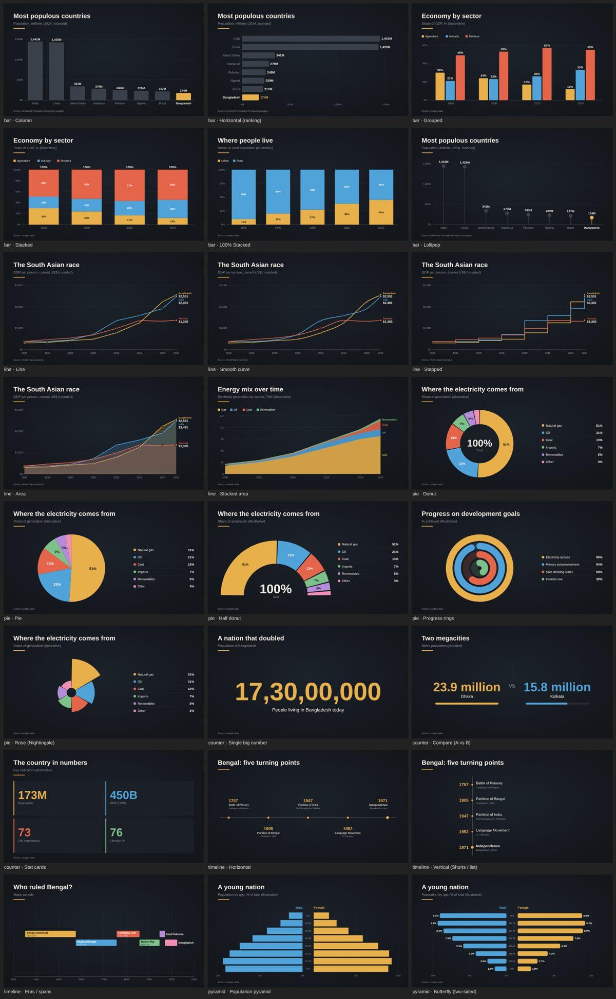
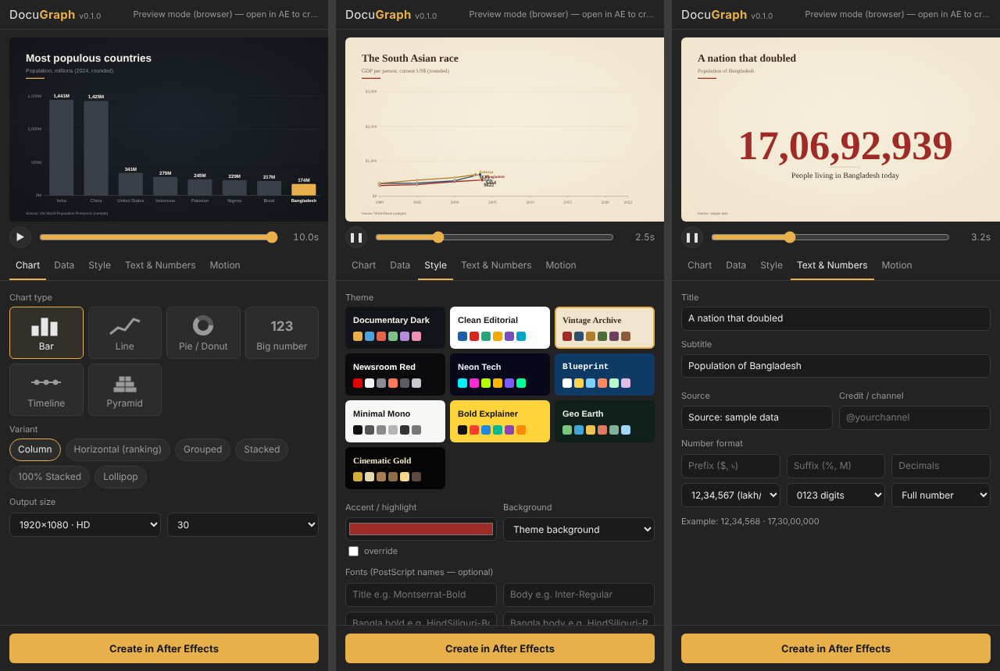

# DocuGraph — animated charts for After Effects

A CEP panel for Adobe After Effects that builds **documentary-grade animated charts** as
**native, editable layers**. You paste data, pick a type and theme, and click once to get a finished comp.

Plan, roadmap and chart catalogue (Bengali): **[PLAN.md](PLAN.md)**



## What's in v0.1

- **6 chart types / 24 variants**: Bar (6 variants), Line/Area (5), Pie/Donut (5), Big Number (3), Timeline (3) and Population Pyramid (2).
- **10 themes**, each of which works with every variant. Output sizes are HD, 4K, 9:16 Shorts, 1:1 and 4:5.
- **Documentary features:**
  - title, subtitle and source line
  - highlight one item and dim the rest
  - count-up numbers
  - line-tip dot with a live value label
  - timeline markers that pop when the line reaches them
  - era/dynasty spans
- **Bengali support:**
  - Bengali labels with automatic Bengali font switching
  - Bengali digits (০১২৩)
  - lakh/crore grouping (12,34,567)
  - the compact suffixes হাজার / লাখ / কোটি
- **Editable output:**
  - shape layers and text layers
  - plain keyframes with matching easing
  - every count-up is a `Progress` slider plus an expression (FROM/TO at the top)
  - everything is parented to a `DG Controller` null, so you can move or scale the whole chart at once
- **Live data in AE:** every value becomes a slider on `DG Controller`. When you change a slider, the bars, slices, labels and axis redraw through expressions. This works for bar (column / horizontal / grouped), line (line / smooth / stepped / area, including the tip dot and its live label), pie / donut / half donut / rings, and big numbers. `Axis Max (0 = auto)` lets you fix the axis.
- **Re-edit:** open a DocuGraph comp, then click **Load from open comp**. Change anything, then click **Update open comp**. The comp keeps its name and stays in place inside parent comps, and any layers you added yourself are kept.
- **Motion Bro-style workflow:**
  - **Gallery** of animated thumbnails: hover to play, click to use.
  - **Create** drops the chart into the open comp at the playhead, as a precomp.
  - Edit it from the layer's **Essential Properties**: title, subtitle and source text, every colour (a Color Control per theme role), the data values, and chart scale / position.
  - Select the chart layer, then use **Load selected chart** and **Update chart**.
- **Table editor** for manual data entry. You can also paste a block from Excel straight into it.
- **The live preview in the panel uses the same engine as the AE render.**



## Install (developer mode)

1. Run `install/install-windows.bat` on Windows or `install/install-mac.sh` on macOS.
   - It copies `extension/` into the CEP extensions folder.
   - It enables unsigned extensions (`PlayerDebugMode`).
2. Restart After Effects and open **Window → Extensions → DocuGraph**.
3. For Bengali text, set **Preferences → Type → Text Engine: South Asian and Middle Eastern** so conjuncts render correctly. You also need a Bengali font installed, such as Hind Siliguri, Noto Sans Bengali or Nirmala UI.

To try the UI without AE, open `extension/client/index.html` in a browser. Preview works there, and "Create" is disabled.

## Data format

Paste data from Excel or Google Sheets (tab-separated) or as CSV. The first row is the header.

| Type | Columns |
|---|---|
| Bar / Line | label (or year), series 1, series 2, … |
| Pie | label, value |
| Big number | label, value, [start value] |
| Timeline | date, title, [note]. For the eras variant: start, end, label |
| Pyramid | group, left value, right value |

Numbers can use Bengali digits, currency symbols, `%`, thousands separators or `K/M/B/T` suffixes.

## Development

```
npm test        # ES3 lint + engine tests (480 builds) + mock After Effects render
npm run sheet   # contact sheet of every variant → docs/img
```

`extension/shared/` must stay **ES3**, because ExtendScript runs the same files. `tests/es3-lint.js` enforces this.

To add a chart type, add `extension/shared/charts/<type>.js` and register it in `host/main.jsx` `DGHost.FILES` and in `client/index.html`. Both renderers support it automatically.
